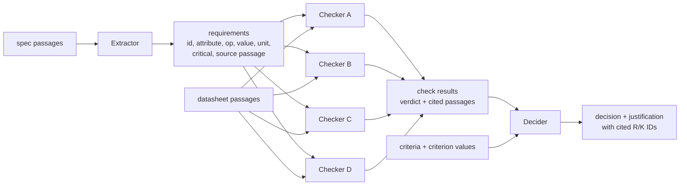
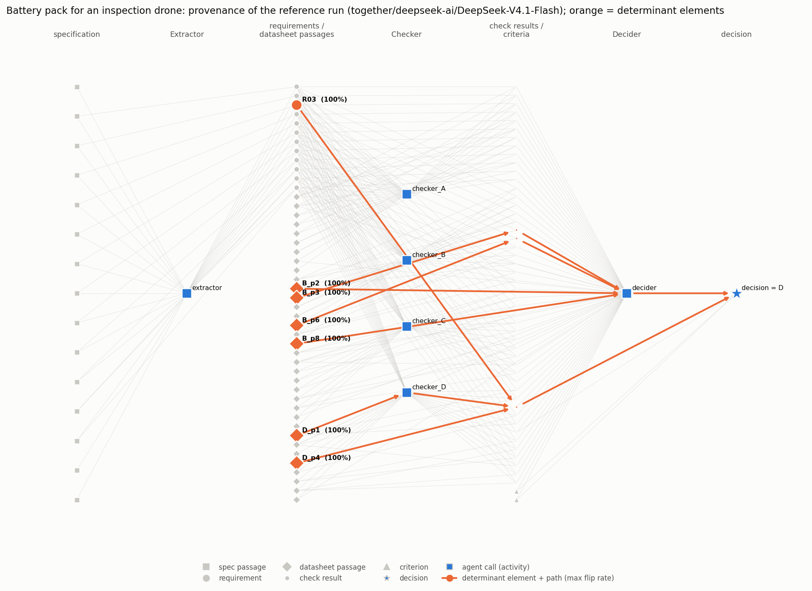

# mas-decision-provenance

**Faithful explanations for a requirements-driven agent chain.**

This small but complete prototype asks, on realistic engineering selection tasks:

1. **How did a multi-agent chain reach its decision?** Every run is recorded as a PROV-style provenance graph.
2. **Which information actually determined it?** Elements selected by the graph are perturbed, only the downstream part of the chain is replayed, and decision flips are tested against the chain's own noise floor.
3. **Does the agent's explanation match?** The requirements the Decider cites in its justification are compared with the elements found determinant (precision and recall).

It extends my REACH work from a single translation step to a chain of three agents.

> **Status.** The pipeline is complete for 3 scenarios and verified end to end offline. The LLM results below come from **one scenario (`drone_battery`) run on DeepSeek-V4.1-Flash** (open weights, via Together, hidden reasoning disabled). The run cost ≈ 0.85 USD in total, a deliberate budget constraint. Full report: [`results/together-deepseek-ai-deepseek-v4.1-flash-noreason/RESULTS.md`](results/together-deepseek-ai-deepseek-v4.1-flash-noreason/RESULTS.md).

---

## Link to the thesis topic

| Research question / challenge in the call | Where it is addressed here |
|---|---|
| **RQ1**: represent how a multi-agent system reached a decision | Provenance graph per run (`provenance/graph.py`): entities, activities, `used` / `wasGeneratedBy` / `wasDerivedFrom`, each tagged with its requirement ID. Exported as JSON, drawn as a figure. |
| **RQ2**: identify the information that determined the decision | Exp. 1: graph-restricted perturbation (removal / alteration / injection) with partial replay; Fisher test against the Exp. 0 noise floor. Exp. 2 checks the agent's own justification against it. |
| **RQ3** (partly): criticality of requirements | Every requirement is marked critical / non-critical (extracted by the agent, scored against ground truth). Determinant elements, justification gaps and injected-error localisation are reported separately for each class. |
| Methodological challenge: **variability** | Exp. 0 measures run-to-run variability at temperature 0 with a fixed seed; it is the null distribution for every significance test. |
| Methodological challenge: **cost** | Partial replay from cached upstream outputs, graph-based element pruning (with post-dominator collapse), curtailed sequential testing, and grouped ablation, with a call-count table. |

---

## 1. Use cases

Three synthetic but realistic component-selection tasks, written for this project (`scenarios/`):

| Scenario | Requirements (critical / non-critical) | Candidates | Selection policy | Correct choice | What makes extraction / checking non-trivial |
|---|---|---|---|---|---|
| `drone_battery`: battery pack for an inspection drone | 12 (7 / 5) | 4 | critical gate, then lowest price, then lowest mass | C | "30 min at 180 W" → ≥ 90 Wh; datasheets give mAh and V or C-ratings; criticality stated implicitly ("precondition for acceptance", "cannot be mounted"); the cheapest pack misses the energy limit by 1.2 Wh |
| `coolant_pump`: coolant pump for a battery test bench | 11 (6 / 5) | 4 | critical gate, then **most recommendations met**, then price | A | L/min vs m³/h, bar vs metres of head; "would require a new power supply … not an option" is a mandatory constraint; non-critical requirements matter through the policy |
| `drag_chain_cable`: power cable for a robot drag chain | 10 (6 / 4) | 4 | critical gate, then price per metre, then diameter | C | current derating at 40 °C; bending radius given as "7.5 × d"; "0.6/1 kV"; one candidate fails **two** critical requirements (redundant causes) |

Each scenario folder has:

- `spec.md`: the specification, with requirements labelled `[R01]`… and phrased in prose;
- `datasheets.json`: datasheet passages, including distractor passages;
- `criteria.json`: the comparison criteria;
- `ground_truth.json`: the requirements (attribute, operator, value, unit, **criticality**), the correct choice and four injected errors for Exp. 3.

Datasheet passages also carry machine-readable `facts`. The LLM agents **never** see them. They serve only to compute the ground-truth check matrix and decision (`agents/rules.py`; consistency is asserted at start-up and in the tests), to drive the offline mock backend, and to route criterion values to the Decider (a fixed, non-LLM retrieval step).

## 2. The agent chain



- **Extractor** (`agents/extractor.py`): one call per specification. Outputs structured requirements with ID, attribute, operator, value, unit, criticality and source passage.
- **Checker** (`agents/checker.py`): one call per candidate. Outputs a verdict per requirement (`pass` / `fail` / `unknown`) and the datasheet passages it cites. It sees only the *structured* requirements, so extraction errors propagate as they would in a real pipeline.
- **Decider** (`agents/decider.py`): one call. Sees the check matrix, the criticality flags, the criteria and the criterion values, selects one candidate and writes a justification that cites requirement and criterion IDs.

All calls run at temperature 0 with a fixed seed (42) and JSON output mode. Every request and response is stored in `results/<model>/llm_calls.sqlite` (`agents/llm.py`); the log of the reported run is committed, so `python run_all.py ...` with the command below reproduces every number without an API key or any cost. The log is also a cache keyed by (model, messages, temperature, seed, *tag*):

- different tags give independent samples, which Exp. 0 needs;
- re-running with the same tags costs nothing and reproduces the results exactly.

Any OpenAI-compatible endpoint works: `groq` (default: Llama-3.3-70B), `together`, `openrouter`, `ollama`, plus `mock` for offline testing.

**Model used for the reported run:** `deepseek-ai/DeepSeek-V4.1-Flash` on Together, with hidden reasoning disabled (`--no-reasoning`). Open Llama models were not available serverless on the account used. With reasoning enabled, the model answered all three scenarios correctly in a smoke test, but each call cost about 3× more. With reasoning disabled the chain makes real errors, which makes it a better object to explain.

## 3. The provenance graph

`provenance/graph.py` turns each run (a JSON *trace*, see `results/<model>/traces/`) into a `networkx.DiGraph`, exported in PROV style (`results/<model>/graphs/*.json`):

| PROV type | Nodes |
|---|---|
| Entity | `spec_S03` (spec passage), `req_R07` (extracted requirement), `ds_C_p2` (datasheet passage), `chk_R07_candC` (check result), `crit_K1` (criterion), `decision` |
| Activity | `act_extractor`, `act_checker_A`…`D`, `act_decider` (one per agent call) |
| Relations | `used` (activity ← entity in its prompt), `wasGeneratedBy`, `wasDerivedFrom`; each carries the requirement ID it concerns |

Example node from an exported graph:

```json
{"id": "chk_R07_candC", "type": "check_result", "requirement": "R07", "candidate": "C",
 "critical": false, "value": "pass", "generated_by": "act_checker_C",
 "used": ["ds_C_p6", "req_R07"]}
```

### Granularity choice

The call names granularity as a research question in its own right. These are the choices made here, and why.

- **One node per requirement, per check result (requirement × candidate) and per passage.** A requirement is the unit engineers reason about and the unit the justification cites. A check result is the smallest piece of information the Decider consumes. A passage (one to three facts) is the smallest piece of evidence an agent can cite. Coarser nodes (whole datasheet, whole specification) would make every perturbation hit many requirements at once, so attribution would be impossible. Finer nodes (individual numbers) would multiply perturbations without a matching unit of explanation.
- **Activities stay at the granularity of the agent call.** The Checker is called once per candidate rather than once per (candidate, requirement) pair. This is a cost trade-off. A base run costs 6 calls instead of about 50. A perturbed requirement still re-runs only 4 checker calls, and a perturbed passage re-runs one. The price is possible *cross-talk*: a change to R07 can alter the verdict on R03 inside the same call. The replay records how many verdicts changed, so this is observable.
- **Two provenance layers are kept apart.** `used` edges record everything that was *in the prompt* (input provenance). `wasDerivedFrom` edges from passages record what the Checker *claims* it used (its citations). Graph-restricted ablation relies on the claimed layer, which is a faithfulness assumption in itself. Exp. 1 therefore probes it directly by removing the passages that were **not** cited and checking that the decision does not move.
- **Collapsing by post-domination.** A specification passage reaches the decision only through the requirement extracted from it: that requirement is its immediate post-dominator. Perturbing the passage is therefore subsumed by perturbing the requirement, which is cheaper because the Extractor does not need to re-run. The graph computes this automatically (`nx.immediate_dominators` on the reversed graph).

Figure: provenance of a reference run, with determinant elements and their paths to the decision in orange (`results/<model>/figures/<scenario>_provenance.png`).

## 4. Experiments

| | What | How | Output |
|---|---|---|---|
| **Exp. 0** natural variability | Unchanged chain, 10 runs per scenario | Decision agreement; per-requirement extraction agreement; check-matrix agreement; citation Jaccard. Accuracy of each step against ground truth | **Noise floor** = runs 1–9 whose decision differs from reference run 0 |
| **Exp. 1** controlled perturbation | Graph-restricted elements (requirements, cited passages, criterion passages, criteria) × {removal, alteration, injection} × 5 replays | Perturb the reference run's state; replay **only** the activities downstream of the element in the graph, reusing cached upstream outputs; one-sided Fisher exact test of the flip rate against the noise floor (Benjamini–Hochberg reported as well) | Determinant set, flip rates, heatmap |
| **Exp. 2** justification faithfulness | IDs cited by the Decider vs IDs found determinant | Precision / recall, *strict* (requirements + criteria) and *lifted* (determinant passages mapped to the requirement whose check cited them), on the reference run and on every Exp. 0 run with the same decision | P / R, cited-but-not-determinant, determinant-but-not-cited |
| **Exp. 3** injected-error benchmark | 4 known errors per scenario (2 on critical, 2 on non-critical requirements; wrong extracted value or corrupted datasheet passage) | Inject, replay, then localise on the faulty run with single-element removal (and grouped ablation for comparison), without knowing where the error is | Consequential? Localised exactly / at requirement level? Rank by flip rate |
| **Cost** | LLM calls needed to find the removal-determinant elements | Naive vs element pruning vs partial replay vs grouped ablation | Call table |

Definitions used throughout:

- **Flip**: the replayed decision differs from the reference decision.
- **Determinant**: removal *or* alteration of the element flips the decision significantly more often than the noise floor (one-sided Fisher, α = 0.05). Alteration multiplies numbers by 0.67 (30 min → 20 min), or uses a scenario-defined alternative value for categorical values.
- **Injection-sensitive**: adding a fabricated sibling (a hallucinated critical requirement, a contradicting "revision note" passage, a fabricated criterion) flips the decision. This is reported separately. A flip under injection shows vulnerability to hallucinated input, not reliance on the original element, so it is **not** counted as determinant.
- **Partial replay** is the main cost-control technique. Upstream outputs are taken from the reference trace, and only activities that are graph-descendants of the perturbed node are re-run. The Decider is always re-run.
- **Curtailed sequential testing** (profile `budget`). Replays run in rounds, and a test stops as soon as no outcome of its remaining replays could reach p < α. With a noise floor of 3/9 and 5 replays, only 5/5 flips is significant (p = 0.028), so a test whose first replay does not flip is finished. The significant / not-significant conclusion is identical to the fixed-replay design. Only the flip-rate estimates of non-significant tests rest on fewer replays. On the mock, the budget profile finds exactly the same determinant set as 5 fixed replays.

## Results

`drone_battery`, DeepSeek-V4.1-Flash (reasoning off), temperature 0, seed 42, `budget` profile: 10 Exp. 0 runs and up to 5 replays per perturbation, curtailed. 854 API calls in total. Full tables: [`RESULTS.md`](results/together-deepseek-ai-deepseek-v4.1-flash-noreason/RESULTS.md).

**Exp. 0: the chain is consistently wrong, and not deterministic at temperature 0.** The correct pack is C. The chain chose D in 7 of 10 runs and B in 3 (noise floor 3/9). Extraction was stable: 100% agreement across runs, values 92% correct, criticality 100% correct. Checks were 96% identical across runs and 91% correct. The Decider's citations were much less stable (mean pairwise Jaccard 0.59).

**Exp. 1: determinant elements** (45 graph-restricted elements × 3 perturbations; one-sided Fisher vs 3/9).

| Element | What it is | Flip rate (removal / alteration) | p | Decision after flip |
|---|---|---|---|---|
| R03 (critical) | operating-temperature requirement | 5/5 / 5/5 | 0.028 | B |
| D_p1 | D's capacity passage (4000 mAh, 22.2 V) | 2/3 / 5/5 | 0.028 | B |
| D_p4 | D's temperature passage | 0/1 / 5/5 | 0.028 | B |
| B_p2, B_p3, B_p6, B_p8 | B's mass, current, cycle-life and price passages (cross-talk, see below) | 5/5 (alteration; B_p8 also removal) | 0.028 | B |

Injection-sensitive (not counted as determinant): B_p1, B_p3, B_p4 and R07. A hallucinated critical cycle-life requirement next to R07 flips the decision. No test survives Benjamini–Hochberg over 135 tests; see Limitations.

**Exp. 2: the justification is unfaithful in a measurable way.** The Decider cites {K1, K2, R03, R06}. Of these, only R03 is determinant: strict precision 0.25, recall 1.00 (mean precision over the 7 Exp. 0 runs with the same decision: 0.17). It cites price and mass (K1, K2) although perturbing either criterion never changes the outcome. It cites R06 although D's R06 verdict is "unknown", which the stated policy says should disqualify D. The determinant passages (D_p1, D_p4, B's passages) never appear, so lifted recall drops to 0.40.

The provenance graph shows *why* the decision is wrong. The determinant elements trace back to three checker errors visible in the trace:

- **D / R01:** the evidence reads "88.8 Wh, which is below 90 Wh", yet the verdict is **pass**. The intermediate agent's own explanation contradicts its output.
- **B / R03:** "−20 °C to +60 °C does not cover −10 °C to 45 °C because it extends below". The range-coverage test is applied backwards.
- **C / R03:** the checker uses C's *charge* temperature range (0–40 °C, the distractor planted in the datasheet) instead of its discharge range.

**Cross-talk confounds element-level determinance.** Replaying the flipped runs from the call log, at zero extra cost, shows which verdicts actually changed:

| Perturbation | Verdicts that changed | Mechanism |
|---|---|---|
| D_p1 altered (capacity ×0.67) | D: R01 pass→fail (and R05) | **direct:** the intended dependency |
| D_p4 altered (temperature ×0.67) | D: R03 pass→fail | **direct** |
| B_p2 altered (mass) / B_p8 removed (price) | B: **R03** fail→pass | **cross-talk:** re-running B's checker call re-judges an unrelated requirement, and the fragile wrong R03 verdict disappears |
| R03 removed | D: 9 other requirements pass→unknown | **cross-talk:** D is disqualified for a reason unrelated to R03 |

So the four B passages are "determinant" only because touching anything in B's checker call re-rolls B's R03 verdict, and the true locus is the check result `chk_R03_candB`. This is the cost of the activity granularity chosen here (one Checker call per candidate; see *Granularity*). It is detectable because each replay records which verdicts changed. A per-(candidate, requirement) Checker would remove it at about 8× the base-run cost.



**Exp. 3** ran only partly; the budget stopped it after E1. E1 (R01 mis-extracted as 110 Wh, critical) was **not consequential**: the reference decision was already D, because the checker passes D on R01 regardless of the threshold. 4 of 5 faulty replays still chose D. Localisation therefore correctly found nothing about R01. The faulty run's only determinant element was R12. E2 and E3 were not run.

**Cost** (calls to find the removal-determinant elements of this scenario):

| Strategy | LLM calls | Saving vs naive | How |
|---|---|---|---|
| naive: every input element, full-chain replay | 1530 | 0% | computed |
| every input element, partial replay | 800 | 48% | computed |
| graph-restricted elements, full-chain replay | 1350 | 12% | computed |
| graph-restricted elements, partial replay, fixed 5 replays | 620 | 59% | computed |
| + curtailed sequential testing | **217** | **86%** | executed |
| grouped ablation (+ curtailed) | 76 | 95% | executed, but **missed R03 and B_p8** |

## Findings and limitations

**From the LLM run (drone_battery, DeepSeek-V4.1-Flash, reasoning off).**

- **Temperature 0 is not deterministic.** The unchanged chain gave two different decisions (D 7, B 3), so a noise floor is necessary, not a formality. At 3/9, three replays can never reach significance (3/3 gives p = 0.09); five can (5/5 gives p = 0.028).
- **The perturbation analysis explains a wrong decision.** It points to R03 and to D's capacity and temperature passages. The trace then shows the three checker errors behind them, including a verdict that contradicts its own evidence ("88.8 Wh, below 90 Wh" → pass).
- **The justification is unfaithful in the Turpin et al. sense, and the gap is measurable.** Precision is 0.25 (0.17 averaged over runs). The Decider cites price and mass, which never matter, and R06, which by the stated policy should have disqualified its choice. Recall is high only in the strict view; the evidence the decision really rests on (passages) is never cited.
- **Cross-talk is the main threat to element-level attribution.** With one Checker call per candidate, perturbing any of B's passages re-judges B's R03. Recording which verdicts changed in each replay separates direct dependencies from cross-talk, but it does so after the fact.
- **Curtailed sequential testing gave the largest cost saving** (86% vs naive, with the same conclusions). Grouped ablation was cheaper still (95%) but missed two of the determinant elements, R03 among them.

**Properties of the method that already show on the offline backend.** The rule-based mock is fully known, so these are properties of the method, not of an LLM.

- **Most of the cost saving comes from partial replay, not element pruning.** Partial replay roughly halves the number of calls. Pruning to graph-restricted elements adds about 10 percentage points, because the Checker cites almost every relevant passage. Grouped ablation saves the most (73–80% vs naive), but…
- **…grouped ablation can mask determinant elements.** When a group is removed together, another route can reach the same decision, so the group is never refined. In `coolant_pump`, removing K1 alone flips the decision, but removing K1 and K2 together does not, so K1 is missed. The report lists what grouped ablation misses relative to single-element removal.
- **Removal is blind to a corrupted passage that disqualifies a candidate.** Removing the passage turns the verdict from `fail` into `unknown`, and `unknown` on a critical requirement disqualifies the candidate just the same. The error is then localised only at the **requirement** level (the requirement becomes determinant in the faulty run). Exp. 3 therefore reports exact and requirement-level localisation separately.
- **Errors that push every candidate into non-compliance are hard to localise.** The policy then falls back to "fewest critical failures", and removing the faulty requirement can lead to the same candidate (`drag_chain_cable` E1: a 70 mm bending-radius limit fails all four cables, and without the limit the cheapest one wins anyway). On the mock, single-element removal localises 5 of the 6 critical-requirement errors at requirement level (2 of 6 exactly). None of the 6 non-critical errors changes the decision, and none is flagged.
- **There are two kinds of determinants.** *Eliminators* are requirements that rule out a cheaper competitor (e.g. R01 rules out the 88.8 Wh pack). *Enablers* are the passages that prove the winner complies. Justifications tend to list everything that was satisfied, and the strict and lifted views separate these cases.

**Limitations.**

- **Budget-limited LLM evidence: one scenario, one model, about 0.85 USD.** Exp. 3 completed only one of its errors (E1, which turned out to be inconsequential), and the other two scenarios ran only on the offline backend. Running `--profile full` on all scenarios needs about 10,000 calls.
- **Statistical power.** With a noise floor of 3/9 and 5 replays, the smallest achievable p-value is 0.028. No result survives Benjamini–Hochberg correction over the 135 tests, so the determinant set should be read as per-test findings, not as a family-wise claim. More replays, or a lower noise floor (e.g. reasoning on), would fix this.
- The reference run is one sample from a non-deterministic chain (run 0 chose D, as 7 of 10 runs did). A different reference run would give a different, overlapping determinant set.
- Small scale overall: 3 scenarios, 10–12 requirements, 4 candidates. The specifications are synthetic and written by the author, so ground truth is clean in a way real specifications are not.
- Using the full-chain Exp. 0 noise as the null for downstream-only replays is conservative.
- Perturbation operators are generic (×0.67, ×1.5, scenario-defined alternatives). Other perturbations may reveal other dependencies, and the result depends on the operator, not only on the element.
- Determinance here is single-element and counterfactual. Redundant causes (a candidate failing two critical requirements) are invisible to single-element removal by design; grouped ablation partly covers them.
- The restricted element set relies on the Checker's citations (claimed provenance). The uncited-passage probe tests this assumption, but only by removal.
- The selection policy text and the prompts are fixed and not perturbed.

## Repository structure

```
mas-decision-provenance/
├── README.md
├── run_all.py               # one command: every experiment, every scenario, report
├── scenarios/               # spec.md, datasheets.json, criteria.json, ground_truth.json per scenario
├── agents/                  # extractor, checker, decider (prompts + parsing), chain + partial replay,
│                            # LLM client with call log/cache, rule engine (ground truth), offline mock
├── provenance/              # graph construction, PROV-JSON export, upstream selection, figures
├── experiments/             # variability, perturbation, faithfulness, injected_errors, grouped, cost, report
├── results/<backend-model>/ # RESULTS.md, summary.json, per-experiment JSON, traces, graphs, figures
├── tests/                   # offline tests (mock backend)
└── requirements.txt
```

## Reproducing

```bash
pip install -r requirements.txt
cp .env.example .env            # put GROQ_API_KEY=... (or another provider) in it
python run_all.py               # Groq / Llama-3.3-70B, full profile, all scenarios
python run_all.py --backend together --model meta-llama/Llama-3.3-70B-Instruct-Turbo
python run_all.py --profile quick --scenarios drone_battery     # smaller run
# the reported run (TOGETHER_API_KEY in .env), about 850 calls; resumes free from the call log:
python run_all.py --backend together --model deepseek-ai/DeepSeek-V4.1-Flash --no-reasoning \
                  --profile budget --scenarios drone_battery --budget-usd 0.65
python run_all.py --backend mock                               # offline pipeline test, NOT results
python -m pytest -q                                            # offline tests
```

Budget: the full profile makes about 10,000 LLM calls (about 800 prompt tokens each) for the three scenarios, mostly from Exp. 1 and from the Exp. 3 localisation. A Llama-3.1-8B model costs well under 1 USD; a 70B model costs a few USD on current hosted pricing. Free tiers are usually too rate-limited for the full profile. An interrupted run resumes from the call log, so already-made calls are not paid twice.

## References

- R. Souza et al., *PROV-AGENT: Unified Provenance for Tracking AI Agent Interactions in Agentic Workflows*, 2025.
- W3C, *PROV-DM: The PROV Data Model*, 2013.
- M. Turpin, J. Michael, E. Perez, S. Bowman, *Language Models Don't Always Say What They Think: Unfaithful Explanations in Chain-of-Thought Prompting*, NeurIPS 2023.
