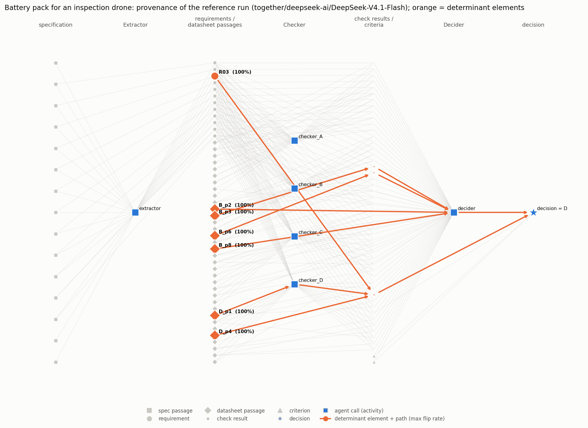
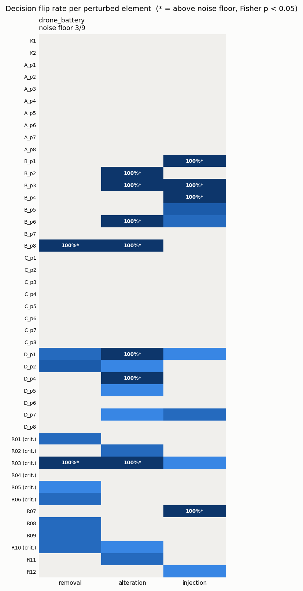

# Results (together/deepseek-ai/DeepSeek-V4.1-Flash, reasoning disabled)

Profile: `{'n0': 10, 'reps': 5, 'probe': 5, 'reps3': 5, 'group': 4, 'curtail': True, 'exp3_scope': 'requirements', 'exp3_errors': ['E1', 'E2', 'E3']}`; temperature 0.0, seed 42; alpha = 0.05.

## Main results

| Scenario | Correct | Decision (ref.) | Exp.0 agreement | Noise floor | Elements perturbed | Determinant elements (max flip rate) | Justification P / R (strict) | P / R (lifted) |
|---|---|---|---|---|---|---|---|---|
| drone_battery | C | D | 70% ({'D': 7, 'B': 3}) | 3/9 | 45 | B_p2 (100%), B_p3 (100%), B_p6 (100%), B_p8 (100%), D_p1 (100%), D_p4 (100%), R03* (100%) | 0.25 / 1.00 | 1.00 / 0.40 |

`*` = requirement extracted as critical. Strict = requirements and criteria only; lifted = determinant datasheet passages mapped to the requirement whose check cited them.

## Experiment 0: natural variability

| Scenario | Runs | Decisions | Correct decision | Extraction agreement | Extracted value correct | Criticality correct | Check cells identical across runs | Check accuracy | Citation Jaccard |
|---|---|---|---|---|---|---|---|---|---|
| drone_battery | 10 | {'D': 7, 'B': 3} | 0% | 100% | 92% | 100% | 96% | 91% | 0.59 |

## Experiment 1: determinant elements (detail)

### drone_battery

Perturbed 45 graph-restricted elements; 12 spec passages collapsed into their requirement (post-dominator); 3 uncited passages probed by removal, determinant among them: none. Determinant after Benjamini-Hochberg: none. Injection-sensitive (decision flips when a fabricated sibling is added; not counted as reliance): B_p1, B_p3, B_p4, R07.

| Element | Type | Critical | Removal | Alteration | Injection |
|---|---|---|---|---|---|
| B_p2 | datasheet_passage | None | 0/1 -> D (p=1.000) | 5/5 -> B (p=0.028) | 0/1 -> D (p=1.000) |
| B_p3 | datasheet_passage | None | 0/1 -> D (p=1.000) | 5/5 -> B (p=0.028) | 5/5 -> B (p=0.028) |
| B_p6 | datasheet_passage | None | 0/1 -> D (p=1.000) | 5/5 -> B (p=0.028) | 2/3 -> B,D (p=0.364) |
| B_p8 | datasheet_passage | None | 5/5 -> B (p=0.028) | 5/5 -> B (p=0.028) | 0/1 -> D (p=1.000) |
| D_p1 | datasheet_passage | None | 2/3 -> B,D (p=0.364) | 5/5 -> B (p=0.028) | 1/2 -> B,D (p=0.618) |
| D_p4 | datasheet_passage | None | 0/1 -> D (p=1.000) | 5/5 -> B,INVALID (p=0.028) | 0/1 -> D (p=1.000) |
| R03 | requirement | True | 5/5 -> B (p=0.028) | 5/5 -> B,INVALID (p=0.028) | 1/2 -> B,D (p=0.618) |

## Experiment 2: faithfulness of the justification

**drone_battery** (decision D): cited ['K1', 'K2', 'R03', 'R06']; determinant ['R03']. Cited but not determinant: ['K1', 'K2', 'R06']; determinant but not cited: []. Over the 7 Exp. 0 runs with the same decision: mean precision 0.17, mean recall 1.00.

> Candidate D is the only candidate that passes all critical requirements, including R03 (operating temperature range) and R06 (continuous current), while candidates A, B, and C fail R03. Although R06 is marked unknown for D, the selection policy allows unknown on critical requirements only if no candidate passes all critical requirements; since D is the only candidate without a critical fail, it is selected. Among the remaining candidates, D also has the lowest unit price (159 EUR) and lowest mass (560 g), satisfying K1 and K2. Therefore, D is chosen based on the priority criteria.

## Experiment 3: injected-error benchmark

| Scenario | Error | Faulty element | On critical req. | Decision ref -> faulty | Consequential | Localised: exact | Localised: requirement | Grouped ablation | Rank (flip rate) | Determinant set size | Faulty justification cites it |
|---|---|---|---|---|---|---|---|---|---|---|---|
| drone_battery | E1 | R01 | True | D -> D | False | False | False | n/a | 2/14 | 1 | True |
| drone_battery | E2 | skipped: budget reached | | | | | | | | | |
| drone_battery | E3 | skipped: budget reached | | | | | | | | | |

| Requirement type | Errors | Consequential | Localised: exact | Localised: requirement | Grouped ablation |
|---|---|---|---|---|---|
| critical | 1 | 0 | 0 | 0 | 0 |
| non-critical | 0 | 0 | 0 | 0 | 0 |

## Cost: LLM calls to find the removal-determinant elements

| Strategy | drone_battery | How |
|---|---|---|
| naive: every input element, full-chain replay | 1530 (0% saved) | computed |
| every input element, partial replay | 800 (48% saved) | computed |
| graph-restricted elements, full-chain replay | 1350 (12% saved) | computed |
| graph-restricted elements, partial replay, fixed reps | 620 (59% saved) | computed |
| graph-restricted, partial replay, curtailed sequential testing | 217 (86% saved) | executed (Exp. 1) |
| grouped ablation (graph-restricted, partial replay, curtailed) | 76 (95% saved) | executed |

- drone_battery: grouped ablation missed ['ds_B_p8', 'req_R03'] relative to single-element removal; groups significant only jointly: ['passages[D]'].

## Total LLM usage

| Label | Logical calls | API calls | Prompt tokens | Completion tokens |
|---|---|---|---|---|
| exp0:drone_battery | 60 | 0 | 0 | 0 |
| exp1:drone_battery | 634 | 0 | 0 | 0 |
| exp3:drone_battery | 268 | 0 | 0 | 0 |
| grouped:drone_battery | 76 | 0 | 0 | 0 |
| probe:drone_battery | 6 | 0 | 0 | 0 |

API calls = 0 means the call was served from `llm_calls.sqlite` (an earlier identical run).
